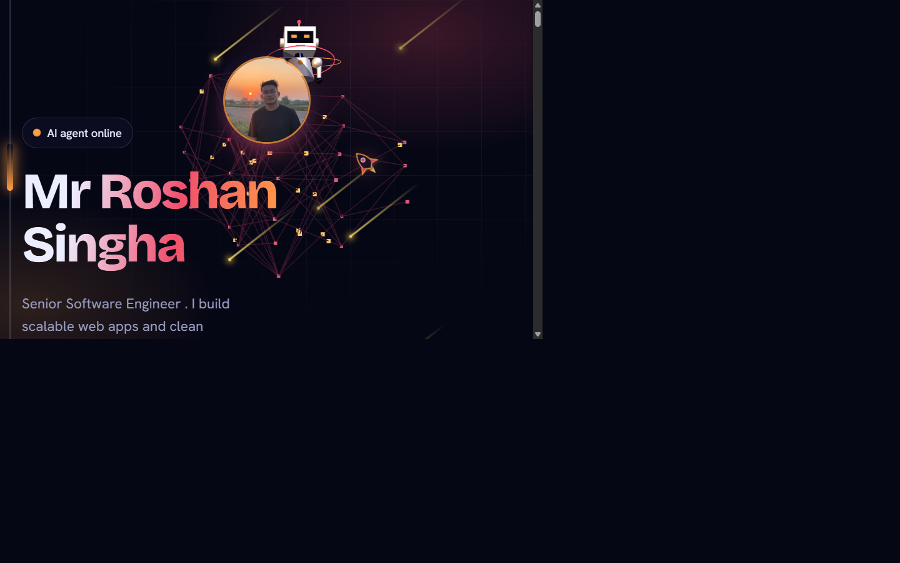

# Mr Roshan Singha - Portfolio

A responsive personal portfolio website for **Mr Roshan Singha**, a senior software developer focused on scalable web applications, microservices, databases, machine learning, and cloud infrastructure.

The site is built with plain HTML, CSS, and JavaScript, so it does not require a framework or build step.

## Portfolio Preview

### Home



## Features

- Responsive, dark-themed portfolio interface
- Animated network, rocket, shooting-star, and scroll effects
- About, skills, education, projects, experience, certifications, and achievements sections
- Interactive profile assistant with predefined portfolio knowledge
- Voice navigation using the browser Web Speech API
- Interactive 3D-style background powered by Three.js
- Reduced-motion support for accessible animation preferences
- Direct links for email, LinkedIn, GitHub, social profiles, and mentoring

## Technology

- HTML5
- CSS3
- Vanilla JavaScript
- Three.js
- Google Fonts
- Simple Icons and Devicon

## Project Structure

```text
.
|-- index.html                  # Main website markup, styles, and scripts
|-- assets/
|   |-- profile.webp            # Profile portrait
|   |-- tapestry-of-resilience.png
|   `-- portfolio-home.png      # README homepage preview
|-- projects portfolio new.code-workspace
`-- README.md
```

## Run Locally

No package installation is required.

### Option 1: Open the file directly

Open `index.html` in a modern browser.

### Option 2: Use a local server

From the project directory, run:

```powershell
python -m http.server 8000
```

Then visit `http://localhost:8000`.

You can also use the **Live Server** extension in VS Code:

1. Open the project folder in VS Code.
2. Right-click `index.html`.
3. Select **Open with Live Server**.

## Browser Support

The portfolio uses modern browser features, including CSS `color-mix()`, WebGL through Three.js, and speech recognition through the Web Speech API.

Voice navigation works only in browsers that support speech recognition and requires microphone permission. The rest of the portfolio remains available when voice recognition or WebGL is unavailable.

## Deployment

This project can be deployed as a static website on:

- GitHub Pages
- Netlify
- Vercel
- Cloudflare Pages
- Azure Static Web Apps

No environment variables or server-side configuration are required.

## Contact

- LinkedIn: <https://www.linkedin.com/in/roshansingha3>
- GitHub: <https://github.com/roshan-gitbot-ai>
- Email: <mailto:lroshansingha@protonmail.com>
- Mentoring: <https://topmate.io/roshan_singha>
